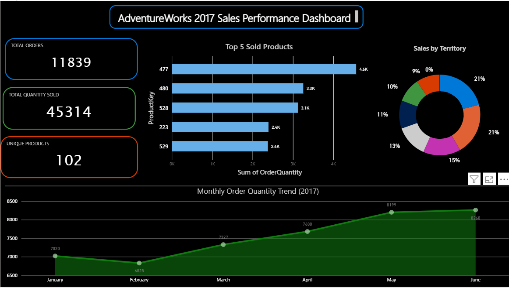

# 📊 AdventureWorks 2017 - Sales Performance Dashboard

## 📌 Project Overview
This project features an interactive **Power BI Sales Performance Dashboard** built using the **AdventureWorks 2017** dataset. It provides executive-level insights into overall sales volume, key performance indicators (KPIs), product distributions, geographic performance, and seasonal monthly trends.

---

## 🎯 Business Questions & Insights
- **Overall Performance:** Tracks total orders, total quantity sold, and cataloged product varieties for 2017.
- **Top Products:** Identifies which products drive the highest order volume and highlights the top 5 performing items.
- **Territory Breakdown:** Analyzes regional contributions to overall sales quantity.
- **Monthly Trend:** Displays order volume progression across the first half of 2017.

---

## 🛠️ Dashboard Architecture & Visuals

### 1. Key Performance Indicators (KPI Cards)
- **Total Orders:** 11,839 transactions.
- **Total Quantity Sold:** 45,314 units.
- **Unique Products:** 102 items cataloged.

### 2. Core Visualizations
* **Top 5 Products (Clustered Bar Chart):** Utilizes `Top N` filtering on `ProductKey` by `OrderQuantity` to highlight top performers.
* **Sales by Territory (Donut Chart):** Breaks down regional sales shares, highlighting top territories like Territory 9 (20.9%) and Territory 4 (20.7%).
* **Monthly Sales Trend (Line Chart):** Illustrates steady growth in order quantities from January (7,020 units) through June (8,260 units).

---

## 🎨 UI & Design Rationale
- **Dark Theme:** Built on a custom dark canvas (`#0F172A`) to reduce eye strain, establish a modern executive aesthetic, and emphasize visual data points.
- **High Contrast Palette:** Features vibrant cyan, mint green, and pink accents for crisp contrast and rapid readability.
- **Visual Containers:** Structured with subtle `10px` rounded borders for clean separation between visual elements.

---

## 📁 Repository Structure
---

## 🚀 How to View & Use
1. Download or clone this repository.
2. Open `AdventureWorks_2017_Sales_Dashboard.pbix` in **Power BI Desktop**.
3. Interact with the visuals, cross-filter territories, and examine monthly trend metrics.

---

## 👤 Author
- **Mohamed Abdelmoneim**
